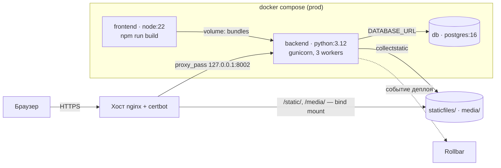

# Star Burger · Infrastructure

[](https://github.com/skislyakow/star-burger-docker/actions/workflows/ci.yml)


[](https://star-burger.kislyakov.pro)


Production-ready инфраструктура для [Star Burger](https://github.com/skislyakow/star-burger) — Django-сервиса доставки еды с витриной, корзиной и панелью менеджера.

Код приложения и инфраструктура разведены по разным репозиториям: здесь живут только `docker compose`, nginx и автоматизация деплоя. Образы собираются из исходников [star-burger](https://github.com/skislyakow/star-burger) прямо при старте контейнеров — второй репозиторий на сервере не нужен.

- **Сайт:** [https://star-burger.kislyakov.pro](https://star-burger.kislyakov.pro)
- **Демо панели менеджера:** [/manager/login/](https://star-burger.kislyakov.pro/manager/login/) — `demo` / `demo-star-burger`

## Инженерные решения

- **Separation of concerns.** Приложение и инфраструктура версионируются независимо: обновление nginx или параметров БД не требует коммита в коде, и наоборот.
- **Источник истины — Git.** Контейнеры сами делают `git fetch` нужного репозитория и чекают `main`, поэтому на хосте не нужно синхронизировать два каталога вручную.
- **Две независимые среды.** Отдельные compose-файлы, volumes и `.env`-файлы для dev и prod: нельзя случайно выкатить демо-данные на прод или обнулить прод-БД локальным `down -v`.
- **Управление порядком запуска.** `healthcheck` на PostgreSQL + `depends_on: condition: service_healthy/service_completed_successfully` — бэкенд не стартует, пока БД не ответит и фронт не соберёт бандлы.
- **Отказоустойчивость.** `restart: always`, автозапуск Docker, named volumes для БД и медиа — после перезагрузки сервера стек поднимается сам, данные сохраняются.
- **Безопасная граница.** gunicorn слушает только `127.0.0.1:8002`, наружу торчит host nginx с certbot; `.env` и `staticfiles/` исключены из Git.

## Архитектура



| | dev | prod |
| --- | --- | --- |
| Compose-файл | `docker/dev/docker-compose.yml` | `docker/prod/docker-compose.yml` |
| Исходники приложения | bind-mount соседнего репозитория | клонируются внутри контейнеров |
| Фронтенд | `npm run watch` | `npm run build` в отдельном контейнере |
| Точка входа | nginx-контейнер, `:80` | хост nginx → `127.0.0.1:8002` |
| Запуск сервисов | вручную | `restart: always` + автозапуск Docker |
| Volumes | `*_dev` | `*_prod` + bind-mount `media/`, `staticfiles/` |

## Стек

| Слой | Технологии |
| --- | --- |
| Оркестрация | Docker Engine, Docker Compose v2 |
| Backend | Python 3.12, Django 5.2, DRF, gunicorn (3 workers) |
| Frontend | Node.js 22, React 17, Parcel 2 (исходники — в репозитории приложения) |
| База данных | PostgreSQL 16, healthcheck через `pg_isready` |
| Веб-сервер | `nginx:alpine` в dev; host nginx + certbot в prod |
| Хранение | named volumes, bind-mount `media/` и `staticfiles/` |
| Мониторинг | Rollbar (уведомление о деплое через Deploy API) |
| Проверки | GitHub Actions: валидация compose-файлов и синтаксиса деплой-скрипта |

## Локальный запуск

Нужны Docker, Docker Compose v2 и Git.

### 1. Расположите репозитории рядом

Dev-конфиг монтирует код приложения из соседней директории `../star-burger`:

```text
<projects>/
├── star-burger/          # код приложения
└── star-burger-docker/   # этот репозиторий
```

```bash
git clone https://github.com/skislyakow/star-burger.git
git clone https://github.com/skislyakow/star-burger-docker.git
cd star-burger-docker
```

### 2. Подготовьте `.env`

```bash
cp .env.example docker/dev/.env
```

В `.env.example` прод-настройки, поэтому для локального HTTP обязательно поправьте `docker/dev/.env`:

```dotenv
DEBUG=True
SECURE_SSL_REDIRECT=False
SECRET_KEY=<любая случайная строка>
ALLOWED_HOSTS=localhost,127.0.0.1
```

Иначе Django будет редиректить `http://localhost` на HTTPS.

### 3. Поднимите стек

```bash
cd docker/dev
docker compose up -d
docker compose logs -f backend frontend
```

При старте контейнеры подтянут код из `star-burger`, установят зависимости через `uv`/`npm`, применят миграции, соберут статику и бандлы, засеют демо-данные.

- Сайт: [http://localhost](http://localhost)
- Панель менеджера: [http://localhost/manager/login/](http://localhost/manager/login/) — `demo` / `demo-star-burger`
- Админка: [http://localhost/admin/](http://localhost/admin/)

Суперпользователь создаётся вручную:

```bash
docker compose exec backend python manage.py createsuperuser
```

Остановка и полная очистка данных:

```bash
docker compose down        # без -v: БД и media сохраняются
docker compose down -v     # вместе с volumes — демо-данные удалятся
```

## Деплой на сервер

Стек поднимается из `docker/prod/docker-compose.yml`. Backend и БД — разные сервисы и разные контейнеры; каждая среда использует свой независимый набор volumes.

```text
/opt/
└── star-burger-docker/     # инфраструктурный репозиторий
    ├── .env
    ├── media/              # bind-mount для загруженных картинок
    ├── staticfiles/        # collectstatic
    └── docker/prod/
```

### Первоначальная настройка

```bash
cd /opt
git clone https://github.com/skislyakow/star-burger-docker.git
cd star-burger-docker
cp .env.example .env
nano .env
```

Выставьте `DEBUG=False`, корректные `ALLOWED_HOSTS`, `SECURE_SSL_REDIRECT=True`, реальный `SECRET_KEY` и параметры БД. Затем возьмите за основу [docker/prod/nginx.host.conf.example](docker/prod/nginx.host.conf.example):

- `proxy_pass http://127.0.0.1:8002;`
- `/static/` → `/opt/star-burger-docker/staticfiles/`
- `/media/` → `/opt/star-burger-docker/media/`
- SSL-блоки certbot на сервере остаются как есть.

### Обновление

```bash
./deploy/deploy.sh
```

Скрипт последовательно:

1. делает `git pull` инфраструктурного репозитория (и приложения, если оно тоже есть на хосте);
2. останавливает legacy-сервис systemd и старый dev compose;
3. пересобирает и поднимает `db`, `frontend`, `backend` и ждёт готовность бэкенда;
4. применяет миграции и собирает статику;
5. проверяет конфиг хостового nginx и делает `reload`;
6. отправляет событие деплоя в Rollbar с хешем коммита;
7. печатает итоговый `docker compose ps`.

`deploy.sh` идемпотентен: повторный запуск безопасен, а `set -e` останавливает деплой на первой ошибке.

### Автовосстановление и данные

Docker включён в автозагрузку, у сервисов прома `restart: always` — после перезагрузки контейнеры поднимаются сами.

- БД — named volume `postgres_data_prod`, бандлы фронта — `frontend_bundles_prod`;
- медиа и статика — bind-mount каталогов `media/` и `staticfiles/` в корне репозитория;
- `docker compose down` без `-v` сохраняет БД, `-v` удаляет **named volumes** (то есть базу). Каталоги `media/` и `staticfiles/` при этом остаются на диске.

Файл `.env` для прома должен лежать именно в корне репозитория — оттуда его читает `deploy.sh` и Compose.

## Переменные окружения

Полный список с комментариями — в [.env.example](.env.example).

| Переменная | Назначение |
| --- | --- |
| `SECRET_KEY` | ключ Django; для dev можно сгенерировать локально, для prod — свой |
| `DEBUG` | `True` локально, `False` на проде |
| `ALLOWED_HOSTS` | список хостов через запятую |
| `SECURE_SSL_REDIRECT` | `True` на проде: HTTPS-редирект и secure-cookies |
| `DATABASE_URL` / `POSTGRES_*` | подключение к PostgreSQL в контейнере `db` |
| `YANDEX_GEOCODER_API_KEY` | расстояния до ресторанов в панели менеджера |
| `ROLLBAR_TOKEN`, `ROLLBAR_ENVIRONMENT` | мониторинг и уведомление о деплое |
| `DEMO_MANAGER_PASSWORD` | пароль демо-менеджера для `seed_demo` |

## Полезные команды

```bash
# из корня репозитория (пром-проверка — с тем же --project-directory, что и в deploy.sh)
docker compose -f docker/dev/docker-compose.yml config --quiet
docker compose --project-directory . -f docker/prod/docker-compose.yml config --quiet

# из docker/dev
docker compose ps
docker compose logs -f backend
docker compose exec backend python manage.py check --deploy
docker compose exec backend python manage.py migrate --noinput
```

## Проверки в CI

[GitHub Actions](.github/workflows/ci.yml) на каждый push и pull request:

- валидирует оба compose-файла через `docker compose config --quiet`;
- проверяет синтаксис `deploy/deploy.sh` через `bash -n`.

Это ловит опечатки в путях монтирования и синтаксические ошибки деплоя до того, как они попадут на сервер.

## Структура репозитория

```text
.
├── .env.example                          # шаблон переменных окружения
├── .github/workflows/ci.yml              # валидация инфраструктуры
├── deploy/deploy.sh                      # автоматический деплой
├── docker/
│   ├── dev/
│   │   ├── docker-compose.yml            # локальная среда
│   │   ├── nginx.dev.conf                # nginx-контейнер для dev
│   │   └── .env                          # локальные секреты (не в Git)
│   └── prod/
│       ├── docker-compose.yml            # продакшен-стек
│       ├── nginx.host.conf.example       # образец конфига хостового nginx
│       └── .env                          # секреты сервера (не в Git)
├── media/                                # загруженные картинки блюд
├── staticfiles/                          # результат collectstatic (не в Git)
└── README.md
```

## Лицензия

[MIT](LICENSE) — как и у основного репозитория [star-burger](https://github.com/skislyakow/star-burger).
